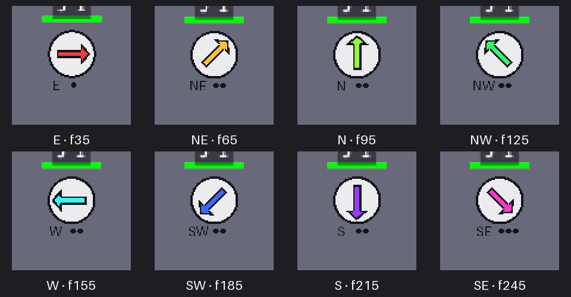

# X-4a — Sprites : directions

Base `origin/main` `00b93b8d`, branche `x-4a-sprites-directions`. Fiche : `docs/taches/plan-1837-cli.md` §3 D-c, §4 X-4a et espace de solution, §5. **Aucune simulation modifiée, aucun nom ni sprite de jeu externe dans l'engine.** Le nouveau contenu visuel est une planche neutre et originale du testbed.

## Contrat et choix

- `SpriteSheetConfig::directions: Option<SheetDirections>` ; absence = 1 direction vers la droite, miroir à gauche (comportement historique, sans changement du RON des clones). Déclaration : `Some((rows: [E, NE, N, NW, W, SW, S, SE], mirror: false))`, une direction dessinée par ligne du bloc, dans l'ordre déclaré ; les animations gardent les indices de la première ligne. Une planche par animation, 12 colonnes × 8 lignes, cellules 376×364 est directement représentable.
- `SheetDirections::choose(FacingDirection) -> RowChoice { row, flip_x }` : plus petite distance angulaire circulaire (pas de 45°) parmi les directions dessinées et, si `mirror`, leurs reflets ; égalité : non retournée avant retournée, puis première ligne déclarée. Unité pure dans `sim_core::sprite_directions` pour que le lint (sans rendu) et la présentation lisent la même déclaration ; rien de ce module n'est attaché à la simulation ni au rollback. Tests 1, 4, 5 et 8 directions, dont égalités et miroir.
- `animation::DirectionRow` est un composant **présentation seule** sur les calques directionnels. `set_sprite_flip` choisit ligne et miroir pour chaque calque d'après **sa** feuille ; l'index d'atlas reçoit `row × sheet.columns`, `animate_sprite_system` retire ce décalage pour avancer l'image puis le remet. Pas de saut de colonne quand l'orientation change ; une feuille sans champ conserve son flip historique et son index inchangé. `create_child_sprite` pose la ligne 0 dès la création, `character_visuals_update_system` la remet à 0 au rechargement. Les exceptions de face/cible et d'orbite ne peuvent plus écraser le flip des calques directionnels : D153.
- Lint de `sprites.ron` : noms de directions RON inconnus et champs inconnus → `Parse`, liste vide, répétition, nombre de lignes de grille non multiple des directions → `OutOfRange` ; feuille sans déclaration inchangée. Fixtures `sprite_sheet_directions_{unknown,rows,ok}`.
- Schéma : `alacod describe SpriteSheet` rend le schéma de la table `sprites.ron` **et** celui des métadonnées de chaque feuille cible (`rows`, `directions`, `mirror`, noms du compas) ; `SheetDirections` dérive `JsonSchema` dans `sim_core`. Lint et schéma lisent les mêmes noms de direction.

## Écran : les huit directions

Planche originale testbed générée par `scripts/generer-sprites-directions.py`, CC0 déclarée dans `games/testbed/assets/assets.yaml` ; 4 colonnes × 8 lignes de cellules 160×160 (rouge E, jaune NE, vert N, vert d'eau NW, cyan W, bleu SW, violet S, rose SE). `scale: 0.2` : 32×32 unités monde. Le scénario `tests/scenarios/sprite_directions_eight.ron` utilise `character: "boussole"`, sans arme et sans ennemis (`testbed/floor_vide_a.ldtk`) : visée dans les huit directions successives, 30 frames chacune. La capture réelle `play_scenario --capture target/videos/x-4a-sprites-directions-final --at 35,65,95,125,155,185,215,245 --size 960x540` a produit huit images ; mosaïque ci-dessous, découpée autour du joueur et agrandie **au plus proche** pour inspection. Les fichiers complets sont dans `target/videos/x-4a-sprites-directions-final/frame_*.png` (non versionnés).

Observation à l'écran : chaque flèche et sa couleur suivent la visée, W est cyan et non un miroir du rouge E ; la planche réduite tient à la place du joueur, le bord et les gros traits restent nets (filtrage `ImagePlugin::default_nearest()`), le texte et les points très fins se pixellisent à 0,2 : une planche finale doit dessiner les détails pour l'échelle réellement utilisée. Le HUD et la barre de santé sont indépendants de la planche ; aucun autre personnage ni clone n'a été modifié. La mosaïque montre 1–3 points selon l'image jouée, donc l'animation continue pendant les rotations.

## Échelle et limites

L'échelle est une décision de jeu : `tile_size` est la cellule source, `SpriteSheetConfig::scale` règle la taille affichée du calque, `anchor` et `offset_x/y/z` règlent sa place, `camera.ron` (`default_player_zoom`, `min_zoom`, `max_zoom_out`) règle le cadrage. Ici 160 px × 0,2 = 32 unités monde = deux cases de 16 ; collider 20×20, caméra du testbed à zoom joueur 1, capture 960×540. Une planche d'humain ~160 px se réduit ainsi sans changer la taille du monde. Deux constantes `world::grid::CELL_SIZE` et `game::character::enemy::ai::navigation::GRID_CELL_SIZE` valent 16 en dur : elles empêchent de choisir la **taille physique de la grille** par jeu (pas l'échelle des sprites). Dette D154 plutôt que refactoring de simulation hors lot.

## Vérifications

- `CARGO_BUILD_JOBS=4 cargo test -p sim_core sprite_directions` : 10 tests verts.
- `CARGO_BUILD_JOBS=4 cargo test -p animation` : 5 tests verts (dont ligne/miroir/index d'atlas).
- `CARGO_BUILD_JOBS=4 cargo test -p content --test lint_fixtures sprite_sheet_directions` : 3 tests verts (noms, nombre de lignes, deux blocs de huit).
- `CARGO_BUILD_JOBS=4 cargo check -p animation -p content -p game --tests` : compilation terminée.
- `CARGO_BUILD_JOBS=4 cargo run -q -p content --bin alacod --profile headless -- lint games/testbed` : aucune erreur ; 115 avertissements de contenu (armes et objets de laboratoire non atteignables).
- `CARGO_BUILD_JOBS=4 cargo run -q -p content --bin alacod --profile headless -- describe games/testbed SpriteSheet` : schéma affiché avec `directions: SheetDirections?`, `rows`, `mirror` et les huit noms `Compass`.
- `CARGO_BUILD_JOBS=4 ALACOD_SCENARIO=sprite_directions_eight cargo test -p scenario --no-default-features --profile headless --test scenarios` : scénario 290 frames joué (joueur vivant, 0 ennemi) ; seule sa trace **nouvelle** `tests/scenarios/sprite_directions_eight.trace` a été écrite avec `ALACOD_BLESS=1`. Aucune trace existante n'est bénie.
- `CARGO_BUILD_JOBS=4 cargo run -p scenario --features render --bin play_scenario -- tests/scenarios/sprite_directions_eight.ron --capture target/videos/x-4a-sprites-directions-final --at 35,65,95,125,155,185,215,245 --size 960x540` : huit images réelles, visualisées ci-dessus.

`CARGO_BUILD_JOBS=4 make test_scenarios` : suite complète verte (`test scenarios ... ok`, 5 tests passés, 0 échec, 12 ignorés ; 1610,95 s). Le scénario nouveau est inclus ; aucune trace existante n'a changé (`git status` : seul `sprite_directions_eight.trace` est nouveau).

## Dettes et docs

- D153 : tourelles immobiles/familiers orbitaux avec une planche directionnelle peuvent garder `FacingDirection` plutôt que leur orientation visuelle supplémentaire ; le flip n'est plus écrasé, mais une direction visuelle dédiée est à dériver hors simulation.
- D154 : taille physique de la grille/du champ de flux en dur à 16 ; hors périmètre.
- `docs/conventions.md` §2 (« 8 directions, de 1 à 8 dessinées ») et §89 (nouveau, numéro annoncé au journal), `docs/taches/dettes.md`, ce rapport, journal `docs/taches.md`.
